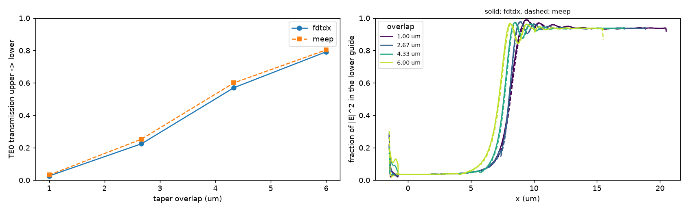

# FDTD with fdtdx

`gdsfactory.fdtdx_stack.StackDevice` turns a component and its
[`LayerStack`](https://gdsfactory.github.io/gdsfactory/notebooks/03_layer_stack/)
into a single [fdtdx](https://github.com/ymahlau/fdtdx) object. Every
`LayerLevel` of the stack is voxelized into one multi-material region, and the
result is differentiable with respect to:

- the polygon vertices of every layer, and therefore the parameters of the cell
  function that drew them;
- the thickness and sidewall angle of every level.

The device also builds a simulation volume that fits it and places sources and
detectors directly on the component's ports. You don't export a GDS, and you
don't re-describe the geometry with fdtdx primitives.

Install the integration with the `fdtdx` extra (requires `fdtdx >= 0.6.3`):

```bash
pip install "gdsfactory[fdtdx] @ git+https://github.com/Sephiram591/gdsfactoryx.git"
```

## Workflow

1. Build the device with `StackDevice.from_layer_stack(component, layer_stack, materials, background, ...)`.
2. Get the matching simulation volume with `stack.get_simulation_volume()`.
3. Put sources and detectors on ports with the `stack.create_<object>_at(port, ...)` methods.
4. Place everything with `fdtdx.place_objects` and merge `init_stack_params(objects)` into the params.
5. Apply the device with `apply_stack` instead of `fdtdx.apply_params`, then run `fdtdx.run_fdtd`.

### 1. Build the device

```python
import fdtdx
import gdsfactory as gf
from gdsfactory.fdtdx_stack import StackDevice, apply_stack, init_stack_params
from gdsfactory.technology import LayerLevel, LayerStack

gf.gpdk.PDK.activate()

layer_stack = LayerStack(
    layers={
        "box": LayerLevel(layer="WAFER", zmin=-3.0, thickness=3.0, material="sio2", mesh_order=9),
        "core": LayerLevel(layer=(1, 0), zmin=0.0, thickness=0.22, material="si", mesh_order=1),
    }
)
materials = {
    "air": fdtdx.Material(),
    "si": fdtdx.Material(permittivity=3.48**2),
    "sio2": fdtdx.Material(permittivity=1.444**2),
}

stack = StackDevice.from_layer_stack(
    gf.components.mmi1x2(),
    layer_stack,
    materials,
    background="air",
    included_layers=["core"],                 # z range of the box: the core ...
    extend_ports=(("o1", 1.0), ("o2", 1.0), ("o3", 1.0)),  # ... plus straight leads out of the ports ...
    boundary_offset=(0, 0, 1, -1, 1, -1),     # ... grown by 1 um in y and z
    name="stack",
)
```

- `materials` maps every `LayerLevel.material` that is drawn, plus `background`,
  to an `fdtdx.Material`. The background fills everything no level covers.
- The box starts as the xy bounding box of the polygons, including the port
  extensions, and the z range of `included_layers`.
  `boundary_offset = (x+, x-, y+, y-, z+, z-)` moves its faces in µm without
  changing the geometry. Every level that overlaps the box is drawn, including
  levels outside `included_layers` such as the `box` oxide above.
- `extend_ports` continues each listed port's cross-section straight out of the
  component. Every stack layer that reaches the port face, over a stretch
  overlapping the port's width, is extended with that stretch's width, so a rib
  waveguide keeps its slab and an etch over the port continues. Use it to run
  waveguides through the PML. To extend only some layers, give them as a third
  element: `("o1", 1.0, [LAYER.WG])`. The extensions are polygons like any
  other: they get the level's thickness, sidewall angle and bias, and they
  follow the port and the polygon edges when the component's parameters change.
- Layers in `fill_layers` (default `WAFER`) cover the whole plane.

The voxelization supports most of `LayerLevel`:

- logical and derived layers;
- `mesh_order` priorities, where the lower value wins;
- `sidewall_angle`, `width_to_z`, `bias` and `z_to_bias`;
- background levels.

### 2. Volume, sources and detectors

```python
volume, constraints = stack.get_simulation_volume()
objects = [volume, stack]
wave = fdtdx.WaveCharacter(wavelength=1.55e-6)
for obj, c in (
    stack.create_mode_plane_source_at("o1", (3, 4), wave_character=wave, port_offset=-0.5),
    stack.create_mode_overlap_detector_at("o2", (3, 4), wave_characters=(wave,), name="out"),
):
    objects.append(obj)
    constraints += c
```

Each `create_*_at` method centers a plane on a port and orients the plane
normal to the port. It returns the object together with its position
constraints. The common arguments are:

| Argument | Meaning |
| --- | --- |
| `port` | port name |
| `port_size_mult` | `(a, b)`: the plane is `a` × port width wide and `b` × level height tall |
| `direction` | `"in"` (into the component) or `"out"`; sources default to `"in"`, detectors to `"out"` |
| `port_offset` | shift in µm along the injection direction; negative values move the plane out of the component, e.g. into a port extension |
| `level` | level whose z span sets the plane's height (default: the levels drawing the port's layer) |

Available objects:

| Method | fdtdx object |
| --- | --- |
| `create_mode_plane_source_at` | `ModePlaneSource` |
| `create_gaussian_plane_source_at` | `GaussianPlaneSource` |
| `create_uniform_plane_source_at` | `UniformPlaneSource` |
| `create_hard_constant_amplitude_plane_source_at` | `HardConstantAmplitudePlanceSource` |
| `create_point_dipole_source_at` | `PointDipoleSource` |
| `create_mode_overlap_detector_at` | `ModeOverlapDetector` |
| `create_poynting_flux_detector_at` | `PoyntingFluxDetector` |
| `create_phasor_detector_at` | `PhasorDetector` |
| `create_field_detector_at` | `FieldDetector` |
| `create_energy_detector_at` | `EnergyDetector` |
| `create_diffractive_detector_at` | `DiffractiveDetector` |

Any other fdtdx fields can be passed as keyword arguments. Add boundaries,
regular fdtdx devices and other objects as usual.

### 3. Place, apply and run

```python
import jax
import jax.numpy as jnp

config = fdtdx.SimulationConfig(
    time=200e-15, grid=fdtdx.core.grid.UniformGrid(spacing=20e-9), dtype=jnp.float32
)
pml = fdtdx.BoundaryConfig.from_uniform_bound(thickness=25)
boundaries, c = fdtdx.boundary_objects_from_config(pml, volume)
objects += boundaries.values()
constraints += c

key = jax.random.PRNGKey(0)
objects, arrays, params, config, _ = fdtdx.place_objects(objects, config, constraints, key)
params = {**params, **init_stack_params(objects)}
arrays, objects, _ = apply_stack(arrays, objects, params, key)
_, arrays = fdtdx.run_fdtd(arrays=arrays, objects=objects, config=config, key=key)
```

fdtdx's own `Device` objects only mix two materials, so `fdtdx.apply_params`
doesn't know about a `StackDevice`. `apply_stack` writes every stack into the
arrays first and then calls `fdtdx.apply_params`, so regular devices and sources
are still updated, and devices win where they overlap a stack.

### Geometry diagnostics

When fdtdx places the device, the device checks the shape every level draws at
the grid's resolution. It warns with a `StackDiagnosticWarning`, one per level
and kind of problem, about:

- **Narrow parts and gaps.** Parts of a level, or gaps in it, narrower than
  1.5 cells divided by `xy_subsamples` (sub-samples resolve thinner features),
  between any two edges that face each other at less than 90°. That includes
  a corner pointing at an edge or at another corner, and a V-notch that nearly
  cuts through a part. The two sides of one corner (sharp, cut, blunt or
  rounded) are the corner, not a narrow part, where they meet at 45° or more.
  Sides meeting at a smaller angle (a needle or a taper) are measured where
  they do not touch, so a sharp tip is never reported but a blunt one is.
  - The shape checked is the one the device draws. Each layer is offset by its
    signed distance, with round joins where it grows at a convex corner or
    shrinks at a reflex one, drawn to within 1% of the threshold. For example,
    two squares whose corners face each other diagonally 0.08 µm apart, grown
    by 0.02 µm, are 0.04 µm apart, not the 0.023 µm of square-cornered
    sizing. A round join belongs to its corner: it is not a narrow part
    together with the edges next to it, so a strip grown with round ends keeps
    its width.
  - Where a sidewall angle, bias or `z_to_bias` offsets the level, the shape is
    checked at enough heights to also find a part that narrows or vanishes, or
    a gap that closes, within the level.
  - Only the box counts. A width or gap is found where one of its two edges
    enters the box, and it is measured and located on the parts of its edges
    in the box. So a gap that narrows toward a point outside the box is
    reported with its width at the box.
  - The warning gives the narrowest one in µm and in cells, a point in its
    middle (x, y and z in µm) and how many places there are. Widths and gaps
    of 1% of the threshold or less are round-off and are left out.
  - Port extensions that end at a box face are not checked at that end.
  - Derived levels are checked on the exact shape they draw (see
    [Geometry model](#geometry-model)). With `derived_shapes="composite"`, or
    for a level that fell back to it, a narrow part can also come from layers
    whose edges coincide: `WG - ETCH` with the etch ending exactly where the
    waveguide ends then draws a sliver twice the offset wide where the level
    grows.
- **Overlapping polygons on a layer that a level shrinks** (only with
  `derived_shapes="composite"`, or for a level that fell back to it), through a
  sidewall angle above `z_ref`, a negative bias, `z_to_bias` or sizing, or a
  growing level that subtracts the layer. The composite distance of a layer is
  the minimum of its polygons' distances, so the level draws each polygon
  shrunk instead of their union shrunk. That opens a slit where an overlap is
  narrower than about twice the shrink. Polygons that only abut are not
  reported (their shared edges are seams), and grows are exact. With the
  default `derived_shapes="exact"`, such a level draws the exact union and is
  not reported.

`stack.diagnose(resolution)` returns the same findings as data, as
`StackDiagnostic` tuples (level, kind, size in µm and cells, threshold,
location, z, count, layers and message). Before the device is placed, pass the
resolution in µm. To turn the warnings off, pass `diagnostics=False` to
`from_layer_stack`, or filter them:

```python
import warnings
from gdsfactory.fdtdx_stack import StackDiagnosticWarning

warnings.filterwarnings("ignore", category=StackDiagnosticWarning)
```

The checks run KLayout on the polygons and the nominal level heights the device
was built with (its initial parameters), not on traced values. They take
milliseconds for typical components (40 ms for a ring resonator). A 2000-tooth
grating whose 1 µm thick level has a 30° sidewall is checked at 64 heights and
takes about 9 s.

### Timing the geometry steps

Every step that builds the geometry can be timed. Timing is off by default and
then costs one global lookup per step; it never changes values or gradients.

```python
from gdsfactory.fdtdx_stack import record_timings

with record_timings() as timings:
    device = StackDevice.from_layer_stack(...)
    objects, arrays, params, config, _ = fdtdx.place_objects(...)
    arrays, objects, _ = apply_stack(arrays, objects, params, key)
print(timings.table())  # per step: calls, wall, trace, compile, run (s)
```

The steps are `from_layer_stack` (laps `compile_levels`, `polygons`,
`port_extensions`, `select_levels`), `derived_shapes`, `place_on_grid`
(`keep_reachable_levels`, `pole_alignment`, `corner_budget`, `diagnose`),
`pack` (`pack_vertices`, `topology_check`), `check_topology`, `retopologize`,
`apply_stack` (`write_stacks`, `apply_params`), `write` (laps `Ex`, `Ey`, `Ez`
or `E`, `set_permittivity`, `conductivity`, step `dispersion`) and, inside
`write` or `material_weights`, `weights` with `level_surfaces`,
`layer_geometry` (where derived shapes are evaluated), `source_sdfs`,
`corner_plan`, `corner_capacity`, `corner_inputs`, `composite` or
`composite_samples`, `corner_pass` and `normal_tensor`. Nested steps also
count in their callers. A step that runs while JAX traces (inside `jax.jit` or
`jax.grad`) counts its wall time as tracing time, which is part of compiling. A
step on concrete values waits for its outputs (`jax.block_until_ready`) when it
ends, and splits its time into compile (JAX's tracing, lowering and XLA
compile events while it runs) and run. Nothing waits inside traced code.

The fdtdx test suites time themselves with
`FDTDX_TIMINGS=<name> pytest tests/test_fdtdx_stack.py tests/test_fdtdx_geometry.py`
(or `--fdtdx-timings=<name>`): the plugin `tests/fdtdx_timing_plugin.py` also
times `fdtdx.place_objects` and `fdtdx.run_fdtd` (step `fdtd_solve`), prints the
per-step table and the slowest tests with their steps, and writes the data to
`.scratch/fdtdx_work/timings/<name>.json`.

### Geometry options and their cost

The geometry features that cost time are collected in `StackOptions`, all on
(the most accurate) by default:

```python
from gdsfactory.fdtdx_stack import StackOptions

device = StackDevice.from_layer_stack(..., options=StackOptions(corner_lines=0))
device.options                                  # StackOptions(...) of a device
StackDevice.from_layer_stack(..., options=StackOptions.fast())  # quick look
```

Each option is also a StackDevice field and can still be passed on its own
(`corner_lines=0`), but not both ways at once. The costs below are wall time
over the full fdtdx test suites (205 tests, 34 min on one L40S, timed with the
plugin above), where most of the time is compiling: tests build many small
devices and compile each once.

| Option (default) | What it buys | Suite cost |
|---|---|---|
| `corner_lines=2` (0: off) | exact fill at polygon corners and edge crossings: corner voxels off by up to 0.25 (convex) and 0.31 (rotated polygons) without, 1e-6 with | 5.7 min (`corner_pass` 176 s, `corner_inputs` 123 s, `corner_budget` 38 s, `corner_plan` 6 s) |
| `averaging="subpixel"` (`"inverse"`) | Kottke averaging: second-order accurate interfaces | part of `composite` painting, at most 4.2 min with everything else painted there |
| `subpixel_normal="voxel"` (`"gradient"`) | the normal of each voxel's own model: exact at slanted walls (0.01 deg), where finite differences of the mean eps are 8-33 deg off | part of the same painting; per call about 1.7x write forward and 2.3x gradient over `"gradient"` |
| `yee_staggered=True` | each E component's own Yee position (first-order error without) | 1.1 min (`write.Ey`, `write.Ez`) plus the corner budget's extra grids |
| `xy_subsamples=1` | (s > 1 refines tips and dense curves; cost ~ s^2) | 1.4 min for the tests that use 2 |
| `derived_shapes="exact"` (`"composite"`) | no slivers where edges of a derived level's layers coincide (0.88 of a voxel before) | < 0.3 min (`derived_shapes` 0.3 s; evaluated within `layer_geometry`, 15 s for all layers) |
| `diagnostics=True` | warnings about unresolved parts and gaps | 0.4 s |

Not switchable, because they are cheap or are the geometry itself: the
per-sub-interval sidewall offsets (inside the painting), the topology check of
`pack` (0.2 s; `pack(check=False)` skips it) and `retopologize` (1 s).
The largest single cost is not a feature: `fdtdx.place_objects` evaluates
`material_weights` eagerly once per placement (for its material mapping),
which compiles the geometry op by op: 8.4 of the suite's 34 min.

## Gradients through the simulation

The stack's parameters live in `params[name]`, in stack units (µm and degrees):

```python
params["stack"] = {
    "vertices/<layer>": ...,       # (E, 2), one entry per source layer with polygons
    "zmin/<level>": ...,           # ()
    "thickness/<level>": ...,      # ()
    "sidewall_angle/<level>": ..., # ()
}
```

Every level's `zmin` is independent: making a film thicker does not lift the
levels deposited on it. To keep them stacked, derive their `zmin` from the
level below inside the objective, e.g. for a cladding deposited on a 0.22 µm
core:

```python
def stacked(t_core):
    return {**params["stack"], "thickness/core": t_core, "zmin/clad": params["stack"]["zmin/core"] + t_core}
```

Every level in the box is computed over the whole box height, so `zmin`,
thickness and roughness can move it anywhere inside the box. Levels outside
the box are not part of the device: pass `level_margin=` (µm) to
`from_layer_stack` to include the levels within that distance of the box, so
that they can be moved into it.

To differentiate with respect to a cell parameter, rebuild the component inside
the objective and swap in its vertices with `stack.pack`:

```python
stack = objects["stack"]

def transmission(width):
    p = {**params, "stack": {**params["stack"], **stack.pack(gf.components.mmi1x2(width_mmi=width))}}
    arrays2, objects2, _ = apply_stack(arrays, objects, p, key)
    _, arrays2 = fdtdx.run_fdtd(arrays=arrays2, objects=objects2, config=config, key=key)
    return jnp.abs(objects2["out"].compute_overlap(arrays2.detector_states["out"])) ** 2

jax.grad(transmission)(2.5)
```

`pack` requires the same polygon topology as the component the device was built
from, meaning the same number of polygons and vertices per polygon on every
layer. Thicknesses and sidewall angles are ordinary entries of the params dict
and can be differentiated directly.

The device also takes a few things from the vertices it is built with, once,
and indexes later vertices with them by polygon and vertex: which corners lie
inside another polygon's edge (T-junctions, such as a taper on the side of an
MMI), which edges are seams between abutting polygons (left out of the
distance), the order of the polygons, which way each one runs, and where each
port extension meets the polygons on the port face. A parameter change that
breaks one of these would otherwise give a wrong geometry without an error: a
taper moved off an MMI side leaves a bump on that side, two abutting polygons
moved apart keep the gap between them filled, and a component that lists two
polygons of the same size in the other order hands each one the other's
topology. So whenever the component is concrete (not traced), `pack` calls
`stack.check_topology(component)`, which raises `ValueError` naming each layer
and what changed in it. Traced components, inside `jax.grad` or `jax.jit`, are
never checked, so the check costs nothing in the objective. Round-off, layout
snapping and moves that keep the topology, such as a taper sliding along an MMI
side or abutting polygons moving together, pass.

All of this is found within one distance, the device's `topology_tol`: a corner
this close to another polygon's edge lies on it, vertices this close to each
other coincide, and a vertex this close to a port face is on it. The default is
2 database units of the layout (`gf.kcl.dbu`, so 2 nm), because snapping to the
1 nm grid can move a corner of a rotated component up to about 1.4 nm off the
slanted edge it lies on; float32 round-off of the coordinates (2 epsilons times
the largest one, about 1.2 nm at 5000 µm from the origin) is added. A corner
within it bends the other polygon's edge through itself, by at most that
distance, instead of leaving a slit between the polygons. The check, a new
device (`from_layer_stack`) and `retopologize` all use the same tolerance, so
whatever the check accepts, a device built for the new vertices would also have.
Moves smaller than it (a taper 1 nm off an MMI side, a waveguide end 1 nm short
of an extended port's face) are accepted as keeping the topology. Abutting
edges whose corners are up to that far apart but not at the same point (which
snapping does not produce from corners that coincide) are a seam too: a voxel
whose center falls in the gap between them, if there is one, is filled as if it
were far outside. Pass `topology_tol=...` (µm) to `from_layer_stack` to change
it.

The check also reports polygons that the component now has on a stack layer
that had none when the device was built: the levels read such a layer as
empty, and a level that needs it (e.g. a slab level of a device built from a
strip waveguide) was not drawn at all. Only `StackDevice.from_layer_stack`
builds a device for them; `retopologize` raises.

When the new topology is intended, `stack.retopologize(component)` returns the
same device (box, levels, materials, placement) with the topology of the new
component; its polygons may also change in number and size. Swap it into the
placed objects and refresh its parameters:

```python
objects = objects.copy()
objects["stack"] = objects["stack"].retopologize(component)
params = {**params, "stack": {**params["stack"], **objects["stack"].pack(component)}}
```

`check_topology` and `retopologize` also take a parameter dict (e.g.
`params["stack"]`) instead of a component, for vertices optimized directly;
port extensions and new layers are then not checked, and the extensions are not
found again. `pack(component,
check=False)` skips the check.

As with the layout backend, don't wrap the cell function in `jax.jit`; see
[Differentiable layouts](differentiable.md). Simulations with lossy materials
should use `fdtdx.GradientConfig(method="checkpointed")`, because fdtdx's
reversible gradients amplify round-off in lossy voxels. `StackDevice` warns
when it detects that combination.

## Geometry model

- **Signed distances.** Each source layer gets a 2D signed distance field to the
  union of its polygons, differentiable in the vertices
  (`gdsfactory.fdtdx_geometry.signed_distance`). Overlapping and abutting
  polygons merge without seams, and partly shared junction edges (a taper on the
  side of an MMI, its corners within `topology_tol` of the side) are made
  exactly shared.
- **Derived levels** (`derived_shapes="exact"`, the default). A level whose
  layer is a boolean of layers (`and`, `or`, `not`, `xor`), or one layer whose
  polygons overlap, is drawn from the exact polygons of that boolean, with its
  own signed distance. They are built once, when the device is built
  (`gdsfactory.fdtdx_geometry.derive_polygons`), as a recipe in which every
  vertex is a copy of a layer vertex or the crossing of the lines of two layer
  edges, and evaluated from the (traced) vertices, so the shape stays
  differentiable in every source vertex. Where the boundary passes from one
  layer's edge to a collinear edge of another (abutting polygons, an edge
  shared by two layers), it gets one vertex from each, joined at zero length,
  so each moves with its own layer. Levels that draw the same boolean share
  one shape, and crossings shared by several shapes evaluate to the same
  numbers. The level's offset (sidewall, bias, `z_to_bias`, and the sizing of
  the whole expression) then offsets that shape with round joins: no slivers
  where edges of its layers coincide (`WG - ETCH` with the etch ending with
  the waveguide), round grown corners of an `and`, and no slits where an `or`
  of abutting or overlapping parts shrinks. On a test device this removed a
  sliver of 0.88 Si at the etched end and halved the corner columns.
  - The recipe is frozen topology, like the polygons' seams:
    `check_topology` (and `pack`) report a shape the new vertices no longer
    draw (a part that appeared or vanished, a seam that opened: e.g. the
    waveguide now reaching past the etch's end), a crossing that left one
    of its edges, and a joint of collinear edges that opened into a step
    (`WG | SLAB` with equal tops, one top moved); `retopologize` builds the
    shapes again. The build and the check accept the same differences from
    the boolean: parts narrower than twice the topology tolerance. Between those
    concrete checks, gradients follow the frozen recipe; at exact
    coincidences they are one-sided. Crossings of nearly parallel edges are
    ill-conditioned (about 1/sin of their angle).
  - Sizing below the expression's root (`WG.sized(...) - ETCH`, anisotropic
    sizing) cannot be drawn this way: such a level keeps the composite model
    below, with a `StackDiagnosticWarning` when the device is built. Sizing of
    the whole expression is part of the level's offset (round joins, not
    KLayout's corner modes).
  - `derived_shapes="composite"` restores the earlier model: derived layers
    combine the layers' fields (`or` takes the min, `and` the max, `not` is
    `max(a, -b)`), offset as a whole. That is the offset of the derived shape
    only where one layer's edge is nearest; where layers' edges coincide it
    draws slivers, and where a level shrinks a layer, overlapping polygons are
    shrunk one by one (see [Geometry diagnostics](#geometry-diagnostics)).
  - Known limit: where two corners of one derived level share a voxel (an
    etch tip on the waveguide's edge), its corner model keeps the half-plane,
    while the composite model, with one literal per layer, is exact there. At
    bias 0 both draw the same shape, and on random stars the exact mode has a
    summed fill error of 0.62 against 0.35 (worst voxel 0.26 against 0); with
    nonzero biases it is far better overall (0.9 against 6.5) with single
    voxels up to 0.12 worse. It is never worse than its own half-plane.
  - Building the shapes costs seconds for tens of thousands of edges (52.8k
    edges: 3 s; the first version took 85 s and 7.7 GB).
- **Sidewalls.** A level at height `z` offsets its distance by
  `(z - z_ref)·tan(sidewall_angle) - bias - z_to_bias(z)`, with
  `z_ref = zmin + width_to_z·thickness`. In each voxel a level takes the mean
  of this offset over the part of the voxel it fills along z (for a straight
  sidewall, the offset at the middle of that part), not the offset at the voxel
  center. The mean is exact for a piecewise-linear `z_to_bias` (its knots split
  the part), and only the level's own surfaces enter it: another level's
  surface cutting the voxel changes nothing. A top or bottom surface that cuts
  a voxel therefore gets the sidewall position at its own height, and a
  sidewall gets its exact volume away from polygon corners, also with a
  `z_to_bias` knot inside a voxel.
  - Per voxel, the area at the mean offset differs from the 3D volume where the
    edge crosses a corner of the voxel's square within the voxel's height (the
    area is quadratic in the offset there). Audits measured up to 5e-3 of a
    voxel at 20° for axis-aligned edges and 2e-2 for edges at 17°; these errors
    cancel along the edge, so the row volume stays exact.
  - Near polygon corners, the corner model (below) paints each level with its
    offsets at the two Gauss-Legendre heights of its part of the voxel and
    takes the mean (again independent of other levels' surfaces). A sloped
    corner's area is quadratic in z, so this is the exact 3D volume, except
    where a vertex or edge crosses a corner or side of the voxel's square
    within the part, or a `z_to_bias` knot lies inside it (a residual of the
    same order as on straight edges). At ±20°, a corner on a voxel center is now
    within 5e-5 of the 3D fill (the cross-section at the middle misses
    `tan²(angle)/12`, 1.1e-2).
  - Where the edge is straight within a corner column's square (a junction of
    two polygons, a port extension, a collinear vertex, or the straight sides
    next to a corner), the two heights alone would differ from the ordinary
    columns' mean offset where the wall crosses a side of the square within
    the voxel (by up to `tan(angle)/(4√3)`, 2.5e-2 of a voxel at 10°), a seam
    along the waveguide. So the corner columns add that seam (the half-plane
    at the mean offset less the half-plane at the two heights): where the
    corner model equals the half-plane at both heights, they get exactly the
    ordinary columns' result, and a straight edge is painted the same in
    every column. The seam fades out smoothly (and differentiably) as the
    corner model leaves the half-plane, over a difference of half the seam's
    size, so a vertex bending off collinear or a corner entering a voxel's
    square moves the fill continuously, with gradients matching finite
    differences (at 10-20°, the slope is at most 2 per cell of motion, where
    the corner first enters the square at one of the two heights and the
    seam fades out, and about 0.5 past the square's side), and a real corner
    keeps the 2-point value. Vertical walls have no seam. The seam is
    added level by level in `mesh_order`, on the union of the levels painted
    up to each, so a level's fill depends only on its own and the earlier
    levels' geometry: a later level's corner in the square, or its surface
    cutting the voxel, changes nothing of it (the straight edge of a sloped
    core next to a corner of a lower-priority level keeps the ordinary
    columns' fill). An earlier level's corner in the square does bend that
    union, so there a later level's straight sloped edge keeps the 2-point
    value (up to `tan(angle)/(4√3)` off the ordinary columns along it).
    Every corner-column voxel thus lies between the cross-section at the
    middle and the 2-point 3D value, to 5e-4 of a voxel where a corner just
    enters the square. On a polygon with corners of all kinds at ±20°, the summed error
    against the 3D fill is 0.93-0.972 of the cross-section's at the middle;
    the largest error per voxel is the straight edges' 2e-2, as in the
    ordinary columns.
- **Painting.** Levels are painted by increasing `mesh_order` by clipping each
  voxel exactly, both laterally and along z between the level surfaces. The
  background gets the rest. Laterally, each level is one half-plane per voxel,
  taken from its distance and gradient at the voxel center. That is exact
  wherever at most one edge of the level crosses the voxel.
- **Corners.** In voxel columns where a polygon corner or a crossing of layer
  edges is within reach, the voxel is painted with the exact local geometry
  instead: each source layer is the intersection or union of its two nearest
  edges' half-planes, combined through the level's layer expression, offset by
  the sidewall, bias and sizing, with round joins where an offset grows a
  convex corner or shrinks a reflex one. This is exact for:
  - any vertex of a source layer, convex or reflex, at any angle, inside or
    just outside the voxel, also across T-junction seams and hole cut lines
    (except near where they split an edge, see below);
  - crossings of edges of overlapping polygons of one layer, and strips or gaps
    between two edges;
  - corners of derived levels where edges of different layers meet, such as
    `WG - ETCH` with the etch edge across the waveguide (with exact derived
    shapes these are ordinary corners of the level's own polygon, with round
    joins where it grows);
  - several levels in one voxel (seams, nesting, `mesh_order`).

  The local model is checked in every voxel. Where a third feature comes within
  reach (edges shorter than about 1.4 cells plus twice the offset, dense curves,
  narrow tips), the result blends back to the half-plane. It is therefore never
  further from the exact fill than the half-plane alone, per z sub-interval
  and, with `xy_subsamples > 1`, for the voxel's average too: all sub-squares
  of a voxel are blended by one weight, the least certain of them, so their
  half-plane errors can no longer cancel unevenly (a weight per sub-square left
  voxels up to 6.8e-3 further off). That costs accuracy where only some
  sub-squares are certified (the largest error in one random test went from
  1.2e-2 to 2.2e-2), and with sub-samples the corner columns reach 0.05 sides
  further. Known limits:
  - With sloped walls, "exact" is the 3D volume where the 2-point rule is
    exact (see Sidewalls), and the half-plane is exact for the cross-section
    at the mean offset only. Against the 3D fill, the never-worse comparison
    then holds up to those residuals: in random tests at up to 25°, a few
    voxels per layer came out further off than the half-plane (up to 1.6e-2,
    against 3.6e-2 before the 2-point rule; on the corner test polygon at
    ±20°, at most 2 voxels per layer by more than 1e-4).
  - Without sub-samples, never-worse holds per z sub-interval; a voxel split
    by level surfaces into sub-intervals where only some are certified can in
    principle still be further off than the half-plane.
  - A hole's cut line ends on an outer edge and splits it, and so does a
    T-junction. Within about 1.4 cells plus twice the offset of a corner of
    that edge, the short piece counts as a third feature, and that corner
    keeps the half-plane result (2.3e-2 off in a test ring shrunk by 0.6
    cells). Fixing this needs a local model of three edges (the corner and the
    split point), or treating collinear pieces as one edge, which the 1 nm
    snapping of a cut point (not exactly collinear) makes inexact.

  `corner_lines` (default 2) is how many lines may split a voxel into cells in
  which every level is a single half-plane. The cost grows about as
  `2^corner_lines + 1`, and 0 turns the corner model off. `corner_columns` is
  the number of columns per sample grid painted this way. It is sized when the
  device is placed, and further columns keep the half-plane result. On a
  130 x 90 x 45 test device, the corner model makes `material_weights` about
  1.5x slower, and its gradient about 1.9x slower. `xy_subsamples` still
  refines the lateral fill at tips, short edges and dense curves, at a cost of
  roughly `s²`.
- **Permittivity averaging.** `averaging="subpixel"` (default) is Kottke subpixel
  averaging along the normal of each voxel's own model, so interfaces in
  neighbouring voxels (a slab under a rib's sidewall, a film next to a wall) do
  not mix. The voxel's ε variance is split into each z sub-interval's
  lateral part, along its kernel-weighted interface flux (tilted out of the
  plane by the sidewall angle), and the vertical profile (along z, tilted by the
  roughness slopes). Variance whose flux cancels inside the voxel (a strip of
  one level between two parts of another) falls back to one-sided differences
  of the mean ε∞. The normal is exact for any single planar interface (slanted,
  horizontal or leaning) and for films of any thickness and position. At
  corners it is a mix of the edges in the voxel. It also handles 2D
  simulations. With `xy_subsamples`, the sub-squares' moments are added up
  per z sub-interval before the normal is taken, so the variance between
  sub-squares counts and a plane on the face between two of them keeps its
  exact normal. The normal stays continuous as an edge crosses that face
  wherever the sub-squares' models agree on the edge: straight edges, and
  corners the corner model certifies. Near a corner painted with half-planes
  (`corner_lines=0`, or beyond the corner model's certified reach), it can
  jump there, by up to about 0.25 in 1/ε for Si in air. The half-plane model
  already jumps by as much without sub-samples (about 0.2 where a voxel
  center crosses the bisector of a corner). With `edge_width` other than 1,
  the sub-squares do not tile the voxel and each gets its own kernel, which
  vanishes on its own sides. A wall in a gap between them, or close to their
  sides, then partly falls back to the one-sided differences. The gradients
  stay finite in float32, also for low-contrast levels (an oxide next to
  silicon) at corner slivers. With `yee_staggered=True` (default), each E
  component is sampled at its own Yee position, with its own normal. On a
  130 x 90 x 45 test device, this normal makes the subpixel `apply_stack`
  about 1.7x slower, and its gradient about 2.3x slower, than finite
  differences of the mean ε would.
  With `xy_subsamples=2` it takes about 4x (forward) and 6x (gradient) as
  long as with 1: 0.41 s and 2.8 s instead of 0.10 s and 0.47 s on an L40S
  GPU, after compiling for about 40 s and 80 s.
  `averaging="inverse"` is fdtdx's inverse-permittivity average; it and
  `material_weights` cost nothing extra. Conductivity is averaged linearly.

### Dispersive materials

Materials can carry an `fdtdx.DispersionModel` (Lorentz or Drude poles), in
which case `Material.permittivity` is ε∞. All stack materials share the same
pole slots, one per distinct `(omega_0, gamma)`. Each voxel then mixes the pole
strengths, which mixes the susceptibilities exactly:
`ε(ω) = ε∞,mix + Σ w_m χ_m(ω)`. Each slot costs memory and time over the whole
simulation, so materials that share poles also share slots. With mode or
plane-wave sources in a dispersive simulation, `apply_stack` can't run inside
`jax.jit` (a limitation of fdtdx 0.6.2), but `jax.grad` works.

### Surface roughness

`TopRoughness` displaces the top surface of one level with a Gaussian random
field:

```python
from gdsfactory.fdtdx_stack import TopRoughness

stack = StackDevice.from_layer_stack(
    ...,
    roughness=[TopRoughness(level="core", rms=0.005, correlation_length=0.05)],
)
```

Dips are filled by the levels deposited on that surface. With
`fill_above=True`, their bottoms follow the surface down. Any other level
covering that height also fills them, by `mesh_order`. Pass `noise_key` to
`apply_stack` to draw a new realization, or `apply_roughness=False` for the
nominal geometry.

## Example: elevator coupler

[`examples/fdtdx_elevator_coupler.py`](https://github.com/Sephiram591/gdsfactoryx/blob/main/examples/fdtdx_elevator_coupler.py)
simulates an adiabatic coupler between two SiN tapers on different levels. TE0
at 619 nm is launched into the upper taper, and the script sweeps the taper
overlap. [`examples/meep_elevator_coupler.py`](https://github.com/Sephiram591/gdsfactoryx/blob/main/examples/meep_elevator_coupler.py)
runs the same structure in MEEP, and
[`examples/compare_elevator_coupler.py`](https://github.com/Sephiram591/gdsfactoryx/blob/main/examples/compare_elevator_coupler.py)
plots the two together:



Run the fdtdx example on a GPU:

```bash
python examples/fdtdx_elevator_coupler.py
```
